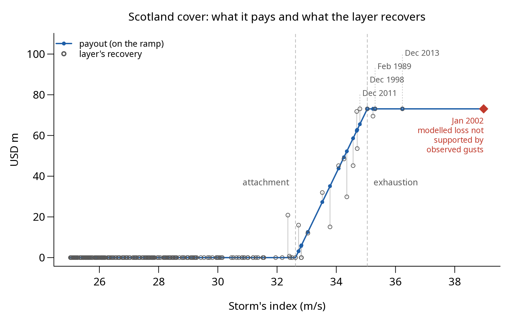

# njord

**Design parametric windstorm covers for regions of the UK.**

njord is an R package built entirely on public data: the Copernicus ERA5
windstorm reanalysis, LitPop asset values and a published damage curve.
It turns 86 years of storms (1940-2025) into modelled losses and designs
a parametric cover for a region: one that pays according to a storm’s
wind strength, not the actual damage done.

To assess such a cover, it is compared, storm by storm, with an ordinary
insurance layer which pays the part of a loss above a *retention* up to
a *limit*. The amount the layer would have paid on a storm is its
*recovery*. The parametric cover’s *basis risk* on that storm is its
payout minus the recovery.

<figure>

<figcaption aria-hidden="true">The frequency-matched Scotland cover,
1940-2025: for each storm with an index of at least 25 m/s, the cover’s
payout (dots, on the ramp) and the layer’s recovery (circles) against
the storm’s wind index. The storm of January 2002 (red) has a modelled
loss not supported by observed gusts.</figcaption>
</figure>

## How it works

njord sets a cover’s trigger with one of three rules, and measures the
cover’s basis risk, storm by storm, both on the storms it was calibrated
on and on storm seasons it was not.

- **Three ways to set the trigger levels** (the wind index at which the
  cover starts paying, the *attachment*, and at which it pays in full,
  the *exhaustion*):
  - `min_index_calibration()` sets the attachment at the weakest wind
    among the storms the layer pays on, so the cover reaches all of
    them, but it also pays on many weaker storms the layer does not pay
    on;
  - `frequency_matching_calibration()` (recommended) ranks the storms by
    wind index and pays on as many of the windiest as the layer pays on
    (18 for Scotland), and in full on as many as the layer pays its
    limit on, so the cover pays about as often as the layer would;
  - `fitted_ramp_calibration()` chooses the levels that bring the
    cover’s payouts as close as possible to the layer’s recoveries over
    all storms.
- **Basis risk is summarised three ways:** its typical size per storm
  (root-mean-square, in USD m), the *false payments* (storms the cover
  pays on where the layer pays nothing) and the *missed storms* (storms
  the layer pays on that the cover does not).
- **Out-of-sample test.** The 87 storm seasons are split into 17 blocks
  of five (the last of seven). Each block is scored with a cover
  calibrated on the other blocks, and the results are pooled.
- **A yardstick.** The *reference cover* ignores the wind and pays every
  storm the same amount, the average recovery of the seasons used for
  calibration. The last column below is the cover’s typical basis risk
  as a fraction of the reference cover’s, a lower number is better.

## Results

Results for the frequency-matched cover, out of sample (90% intervals):

| Cover | Typical basis risk per storm, USD m | False payments / missed storms | Fraction of the reference cover’s (lower is better) |
|----|---:|---:|---:|
| Scotland | 1.2 (0.8 to 1.6) | 3 / 2 | 0.21 (0.13 to 0.31) |
| England and Wales | 12.0 (8.5 to 15.1) | 6 / 4 | 0.78 (0.55 to 1.11) |

- **Scotland works, in the model’s own terms.** The basis risk is small.
  In sample the cover pays on 18 storms against the 18 the layer pays
  on, with 2 false payments and 2 missed storms, and its basis risk is
  0.20 of the reference cover’s.
- **England and Wales is harder.** Its basis risk is only a little below
  the reference cover’s, and the interval includes 1, so the wind index
  adds little there.

## Modelled losses, data issues and next steps

### Modelled losses and the size of the errors

The covers are measured against modelled losses, not real ones, so the
results say how well the method works, not how a cover would pay on real
losses. The modelled loss is built from the same ERA5 gusts as the wind
index, so any error in those gusts is shared by both and does not show
up as basis risk. The errors are large: against station gusts in
published storm reports, ERA5 differs by several m/s for individual
storms, and by 7 to 10 m/s for some, while the damage curve is steep
(the modelled damage ratio rises 11.6 times from 27 to 32 m/s). The
January 2002 storm marked in the figure is an example: its modelled
Scottish loss is not supported by the observed gusts.

### Incomplete catalogue

The storm tracks come from the C3S Hodges product. 25 of the 77 storms
named by the Met Office in the last ten seasons have no track in it,
including Éowyn, the largest UK windstorm loss since 2022, and the other
C3S product (TempestExtremes) does not fill the gaps.

### Planned next

- smaller regions and indices that weight the strongest gusts more,
  since a mean gust is a poor guide to losses in a large, varied region;
- comparison of modelled losses with observed gusts and published
  insured losses;
- a sensitivity analysis of the results to errors in the gust field;
- a decomposition of basis risk by source.

The [vignette](docs/njord-method.md) has the evidence and the full list
of planned refinements.

## Quick start

**Try the demos.** They read only the small files in `inst/extdata/`, so
no data download or Copernicus account is needed. They load the package
from the source with `devtools::load_all()`, so they run from a clone of
the repository, not from an installed copy. Clone the repository and run
them from its root:

``` bash
git clone https://github.com/awkward-crow/njord
cd njord
```

With R, the packages in `DESCRIPTION` and devtools,

``` sh
Rscript inst/demos/calibration_demo.R  # the Scotland cover, in seconds
Rscript inst/demos/ciara_demo.R        # Storm Ciara, footprint to loss
```

Alternatively, make use of the nix flake in the repository, which
provides all of these,

``` sh
nix develop --command Rscript inst/demos/calibration_demo.R
nix develop --command Rscript inst/demos/ciara_demo.R
```

Each demo prints a short report. Run from an interactive R session, for
example with `source("inst/demos/calibration_demo.R")`, each also draws
its plot; the calibration demo’s plot is the one at the top of this
page.

**Use the package in your own R code:**

``` r
# install.packages("remotes")
remotes::install_github("awkward-crow/njord")
```

## More detail

The [vignette](docs/njord-method.md) describes the methods and results
covered here in much greater detail.

## Use of AI tools

Claude Code (Anthropic) assisted with the code, tests and analysis
scripts. The author specified the methods, directed the work and
reviewed the code closely.

The git history carries `Co-Authored-By` trailers.
