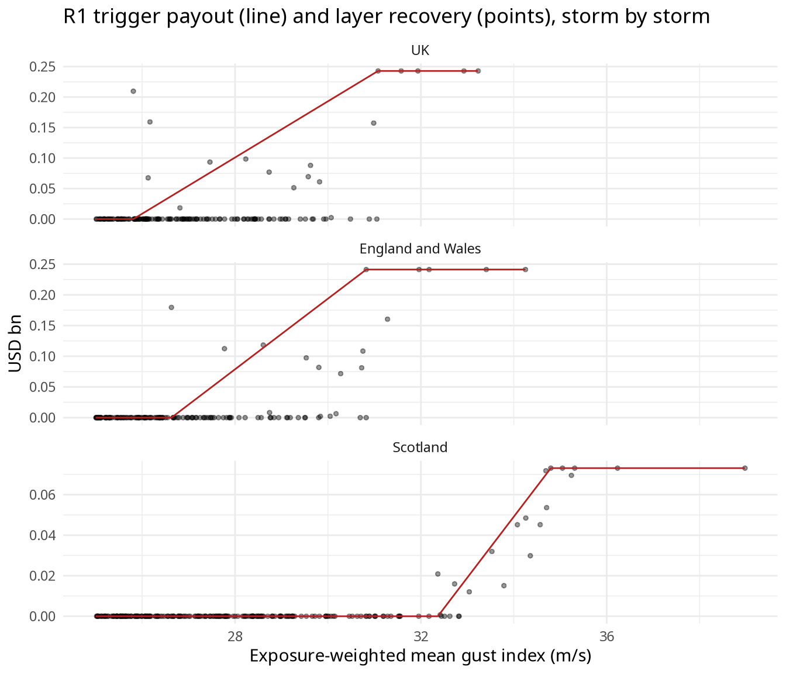

njord: method and results
================

This vignette describes how njord builds a modelled UK windstorm loss
from public data, designs parametric covers on it and measures their
basis risk. Its results are computed from the small files in
`inst/extdata/`, so it builds from a fresh checkout without the raw data
or a CDS account.

``` r
library(njord)
```

## Data

### ERA5 windstorm reanalysis

Hazard data come from the Copernicus Climate Change Service (C3S)
Enhanced Windstorm Service (EWS) dataset
(`sis-european-wind-storm-reanalysis`; Copernicus Climate Change
Service, 2025), derived from the ERA5 global reanalysis (Hersbach et
al., 2020).

For each identified storm event the dataset provides:

- **Footprints** — the maximum 10-metre wind gust (m s⁻¹) over a 72-hour
  window centred on the storm’s peak land impact, on a 0.25° × 0.25°
  grid (~28 km). Njord uses the native ERA5 resolution (0.25°) product.
  Each footprint is restricted to a 1000 km radius around the storm
  track to avoid cross-contamination between contemporaneous events.

- **Track catalogue** — 6-hourly positions, mean sea level pressure and
  10 m gust speed at the storm centre for all tracked systems 1940–2025.
  Two tracking algorithms are available: *Hodges* (TRACK; Hodges,
  1995, 1999) which follows 850 hPa relative vorticity and
  *TempestExtremes* which tracks MSLP minima. Njord uses the Hodges
  product, consistent with CLIMADA’s default configuration and Mishra et
  al. (2026).

- **Summary indicators** — pre-computed annual storm counts, mean gust,
  Storm Severity Index (SSI), normalised SSI, area ratio and wind gust
  ratio, aggregated by NUTS region (NUTS0/1/2) and wind speed threshold
  (0, 15.6, 20, 25 m s⁻¹) for 1940–2025 (~170 000 rows).

The footprint archive (downloaded via the `ecmwfr` package) currently
comprises **721 monthly zip files** (from footprints_hodges_194002.zip
through to footprints_hodges_202604.zip) each containing one or more
NetCDF footprint files for storms active in that calendar month.

## Vulnerability model

The **Schwierz et al. (2010)** damage model is used to estimate the mean
damage ratio (MDR) as a function of wind gust speed $v$:

$$\text{MDR}(v) = \text{MDD}(v) \times \text{PAA}(v)$$

where MDD (mean damage degree) is the expected fraction of asset value
destroyed given that the asset is affected and PAA (percentage of assets
affected) is the probability that an asset at this location suffers any
damage at all. Both are empirically derived nonlinear lookup tables,
originally calibrated against UK insurance losses from named storms in
the period 1987–1990 (Schwierz et al., 2010) and subsequently validated
across multiple European countries.

The model is implemented in the open-source
[CLIMADA](https://climada-python.readthedocs.io/) platform (ETH Zurich;
Aznar-Siguan and Bresch, 2019) as `ImpfStormEurope.from_schwierz()`;
njord uses the same curve nodes (`schwierz_mdr()`).

The MDR surface is multiplied pointwise with the LitPop asset exposure
(Eberenz et al., 2020) — a globally consistent dataset that
disaggregates national asset values in proportion to nightlight
intensity × population, used here at 150 arcsec (~5 km) and summed to
the 0.25° footprint grid — to yield modelled monetary losses per grid
cell and per event. The sum over a region is the storm’s **modelled
loss** there, the benchmark against which a cover’s payouts are judged;
no real indemnity losses are used.

### UK recalibration

Mishra et al. (2026) recalibrate the Schwierz model against PERILS
industry loss data (1999–2024) for 12 European countries using CLIMADA,
with the same hazard (C3S EWS footprints) and exposure (LitPop) as
njord. The paper is a preprint under review. One parameter is fitted per
country: the MDD curve is multiplied by a common factor and the PAA is
left unchanged. The fit is made separately with RMSE and RMSLE cost
functions. RMSE is driven by the largest events and fits the tail; RMSLE
fits the frequent, mid-range events. For the UK both lower the curve:
the maximum MDD is about 0.030 (RMSE) and 0.033 (RMSLE), against 0.0373
for the original, factors of about 0.8 and 0.88. The paper gives these
only in a figure (Fig. 3m–n), so the factors are read by eye from it.
njord uses `mdd_scale = 0.8`, the RMSE fit, since the trigger is
concerned with the tail.

## Trigger

The trigger index in njord is an **exposure-weighted mean peak gust**,
computed for each storm event over a region as:

$$I = \frac{\sum_{i} w_i \cdot v_i}{\sum_i w_i}$$

where $v_i$ is the footprint gust (the storm’s maximum 10-metre gust
over the 72-hour window) at grid cell $i$ and $w_i$ is the value of the
LitPop assets in that cell within the region (`exposure_weights()`,
`weighted_mean_index()`). The sum is over the cells with assets in the
region; a cell on a regional border counts in each region by its share
of the cell’s UK land. Weighting by assets makes the index follow the
gusts where the insured value is.

Two designs are calibrated: one cover for the whole UK and a pair of
covers, one for England and Wales and one for Scotland, each on its own
regional index and losses, whose payouts are added.

The parametric payout follows a **linear ramp** structure:

$$P(I) = \begin{cases}
0 & I < A \\
L \cdot \dfrac{I - A}{E - A} & A \le I \le E \\
L & I > E
\end{cases}$$

where $A$ is the attachment (trigger) level, $E$ is the exhaustion level
and $L$ is the policy limit. Each cover is designed to pay a **layer**
of its region’s losses: the loss above the 1-in-5 year loss (the
retention), up to the 1-in-20 year loss, so the limit $L$ is the
difference between the two. The return periods are illustrative and
would be negotiated in a real transaction. Three rules set $A$ and $E$:

- **R1**, `min_index_calibration()`: each level is the lowest index
  among the storms whose loss exceeds the retention or the 1-in-20 year
  loss.
- **R2**, `frequency_matching_calibration()`: as many storms trigger a
  payout as have a recovery, and as many receive the full limit as have
  a loss above the 1-in-20 year loss.
- **R3**, `fitted_ramp_calibration()`: the levels that minimise the sum
  over all storms of the squared basis risk, or of its absolute value.

## Basis risk

For each storm event $e$, the basis risk of a cover is defined as:

$$B_e = P_e - R_e$$

where $P_e$ is the parametric payout and $R_e$ is what the layer would
recover: the storm’s modelled loss above the retention, capped at the
limit (`basis_risk()`), both expressed as fractions of the total UK
assets. Positive values indicate over-payment (the trigger pays more
than the layer would); negative values indicate under-payment (the
insured bears a loss the layer would have covered).

The distribution of $B_e$ across the historical event set characterises
the basis risk of the trigger design. It has two sources: storms whose
index passes the attachment but whose loss stays below the retention,
which are paid when the layer would pay nothing, and storms whose loss
reaches the layer but whose index stays low, which are paid too little
or nothing.

Over the event set (1,323 storms, 1940–2025, the same for every cover)
the UK cover under R1 pays the largest storms in full, but 120 storms
pay out against 18 that would recover, so it pays about four times what
the layer would each year. Splitting the UK into an England and Wales
cover and a Scotland cover roughly halves the number of storms paid with
nothing to recover (49 against 103). It also pays in full the storm that
hit Scotland hardest (January 2002), which the UK cover misses. The
Scotland cover tracks its layer closely; the England and Wales cover
does not. The two regional covers together are, however, a bigger cover
than the UK one: their limits add up to USD 0.314 bn against 0.243 bn,
and their layers would recover USD 0.036 bn a year against 0.028 bn. So
each cover is best judged against its own layer rather than against the
other. The figures come from the tables below.

## Results in sample

Basis risk here is measured against a modelled loss built from the same
ERA5 gust field as the index, so errors in that field are not part of it
(see [Limits](#limits)).

The event set is the package’s current definition: the storms of
1940–2025 with a UK maximum gust above 25 m/s, less those that share a
maximum gust with a nearby storm (`shared_max_within_72h()`). A storm
with no gust values in a region (NA in the CSV) has index 0 there.
Losses are under the Schwierz curve with the MDD scaled by `mdd_scale`,
as a fraction of the total UK assets, so the covers’ amounts can be
added.

``` r
first_year <- 1940
last_year <- 2025
gust_threshold <- 25
mdd_scale <- 0.8
attach_rp <- 5
exhaust_rp <- 20
block <- 5
n_boot <- 5000
seed <- 1
jennifer <- 1346
plot_min_index <- 25
```

``` r
file_names <- c(values = "uk_storm_values.csv",
                uk_index = "uk_exposure_gust.csv",
                uk_loss = "uk_storm_losses.csv",
                ew_index = "ew_exposure_gust.csv",
                ew_loss = "ew_storm_losses.csv",
                sco_index = "sco_exposure_gust.csv",
                sco_loss = "sco_storm_losses.csv",
                cover = "uk_nuts1_cover.tif",
                assets = "uk_litpop_025deg.tif",
                r3_insample = "insample_fitted_ramp.csv",
                r3_holdout = "holdout_fitted_ramp.csv")
files <- vapply(file_names, function(f)
  system.file("extdata", f, package = "njord"), character(1))
```

``` r
# One column of a per-storm CSV, keyed by track id, under a new name.
read_column <- function(file, name)
  setNames(read.csv(file), c("track_id", name))

storms <- read.csv(files[["values"]])
storms$central_time <- as.POSIXct(storms$central_time, tz = "UTC")
for (k in c("uk_index", "uk_loss", "ew_index", "ew_loss", "sco_index",
            "sco_loss"))
  storms <- merge(storms, read_column(files[[k]], k))

year <- lubridate::year(storms$central_time)
events <- subset(storms, !shared_max_within_72h(storms) &
                   max_gust > gust_threshold &
                   year >= first_year & year <= last_year)
scheme <- season_folds(first_year, last_year, block = block)
years <- sum(scheme$years)
events_per_year <- nrow(events) / years
total_assets <- sum(exposure_weights(files[["cover"]], files[["assets"]],
                                     regions = "UK")$weight)
usd_bn <- function(x) x * total_assets / 1e9
usd_m <- function(x) x * total_assets / 1e6

region_events <- function(region) {
  index <- events[[paste0(region, "_index")]]
  data.frame(event = events$track_id, central_time = events$central_time,
             index = ifelse(is.na(index), 0, index),
             loss = mdd_scale * events[[paste0(region, "_loss")]] /
               total_assets)
}
ev <- lapply(c(uk = "uk", ew = "ew", sco = "sco"), region_events)
c(storms = nrow(events), per_year = round(events_per_year, 2))
#>   storms per_year 
#>  1323.00    15.38
```

R1 and R2 are computed here. R3 takes minutes to fit, so its in-sample
levels are read from `inst/extdata/insample_fitted_ramp.csv`, written by
`inst/scripts/holdout_fitted_ramp.R`. The file’s header records the
settings and storms it was made with; they are checked against those
here (code not shown), and the vignette stops if they differ.

Each cover is a layer on its own region’s losses. For each cover and
rule the attachment and exhaustion are set, each storm’s payout and
recovery computed and the payouts scored against the recoveries. The
combined cover adds the England and Wales and Scotland payouts and
recoveries storm by storm; it has no levels of its own.

``` r
# The loss with return period rp years, as in the calibration functions.
loss_at <- function(loss, rp, events_per_year)
  unname(quantile(loss, 1 - 1 / (rp * events_per_year)))

# Scores of a cover's payouts p against its recoveries r, storm by storm,
# as in holdout_summary(): the no-index cover pays every storm the mean
# recovery.
score <- function(p, r, years)
  c(paid = sum(p > 0), recovering = sum(r > 0),
    false_payments = sum(p > 0 & r == 0), misses = sum(r > 0 & p == 0),
    rms_basis_risk = sqrt(mean((p - r)^2)),
    rms_to_baseline = sqrt(sum((p - r)^2) / sum((mean(r) - r)^2)),
    paid_to_recovery = sum(p) / sum(r), correlation = cor(p, r),
    annual_payout = sum(p) / years, annual_recovery = sum(r) / years)

# The index of the first storm in a space-separated list of track ids.
setter_index <- function(region, setters)
  ev[[region]]$index[ev[[region]]$event == strsplit(setters, " ")[[1]][1]]

live <- list(R1 = min_index_calibration, R2 = frequency_matching_calibration)
r3_losses <- c(R3 = "squared", R3abs = "absolute")
in_sample <- lapply(setNames(names(ev), names(ev)), function(region) {
  e <- ev[[region]]
  index_vec <- setNames(e$index, e$event)
  loss_vec <- setNames(e$loss, e$event)
  retention <- loss_at(e$loss, attach_rp, events_per_year)
  limit <- loss_at(e$loss, exhaust_rp, events_per_year) - retention
  levels <- lapply(live, function(method)
    method(index_vec, loss_vec, attach_rp = attach_rp,
           exhaust_rp = exhaust_rp, events_per_year = events_per_year))
  # The stored levels are rounded, so each is replaced by the exact index
  # of the first storm recorded as setting it.
  for (k in names(r3_losses)) {
    row <- r3_insample[r3_insample$region == region &
                         r3_insample$loss == r3_losses[[k]], ]
    levels[[k]] <- list(
      attachment = setter_index(region, row$attachment_events),
      exhaustion = setter_index(region, row$exhaustion_events))
  }
  setter <- function(level) paste(e$event[e$index == level], collapse = " ")
  recovery <- pmin(pmax(e$loss - retention, 0), limit)
  list(retention = retention, limit = limit, recovery = recovery,
       rules = lapply(levels, function(lv)
         list(attachment = lv$attachment, exhaustion = lv$exhaustion,
              set_by = paste(setter(lv$attachment), "/",
                             setter(lv$exhaustion)),
              payout = payout(e$index, lv$attachment, lv$exhaustion,
                              limit))))
})
rules <- names(in_sample$sco$rules)
in_sample$combined <- list(
  retention = in_sample$ew$retention + in_sample$sco$retention,
  limit = in_sample$ew$limit + in_sample$sco$limit,
  recovery = in_sample$ew$recovery + in_sample$sco$recovery,
  rules = lapply(setNames(rules, rules), function(k)
    list(attachment = NA, exhaustion = NA, set_by = "",
         payout = in_sample$ew$rules[[k]]$payout +
           in_sample$sco$rules[[k]]$payout)))
in_sample_scores <- lapply(in_sample, function(cv)
  lapply(cv$rules, function(rl) score(rl$payout, cv$recovery, years)))
```

In each table, *paid* is the storms paid against the storms with a
recovery (above the retention), *false* the storms paid with no recovery
and *missed* the storms with a recovery but paid nothing. *RMS / no
index* is the RMS basis risk over that of a cover paying every storm the
mean recovery. Amounts are in USD.

**Scotland, layer USD 0.073 bn xs USD 0.054 bn.**

| rule | attach m/s | exhaust m/s | set by | paid | false | missed | RMS USD m | RMS / no index | paid / layer | correlation | USD m a year paid / recovered |
|:---|:---|:---|:---|---:|---:|---:|---:|---:|---:|---:|:---|
| R1 minimum index | 32.37 | 34.80 | 344 / 1578 | 22 / 18 | 5 | 1 | 1.6 | 0.27 | 1.17 | 0.97 | 11.2 / 9.6 |
| R2 frequency matching | 32.62 | 35.05 | 1642 / 1266 | 18 / 18 | 2 | 2 | 1.2 | 0.20 | 1.03 | 0.98 | 9.9 / 9.6 |
| R3 fitted ramp, squared | 32.62 | 35.24 | 1642 / 1567 | 18 / 18 | 2 | 2 | 1.2 | 0.20 | 0.98 | 0.98 | 9.4 / 9.6 |
| R3 fitted ramp, absolute | 32.81 | 35.05 | 1848 / 1266 | 16 / 18 | 1 | 3 | 1.2 | 0.20 | 0.98 | 0.98 | 9.5 / 9.6 |

**England and Wales, layer USD 0.241 bn xs USD 0.183 bn.**

| rule | attach m/s | exhaust m/s | set by | paid | false | missed | RMS USD m | RMS / no index | paid / layer | correlation | USD m a year paid / recovered |
|:---|:---|:---|:---|---:|---:|---:|---:|---:|---:|---:|:---|
| R1 minimum index | 26.63 | 30.82 | 1014 / 926 | 65 / 18 | 48 | 1 | 22.8 | 1.29 | 3.12 | 0.64 | 81.0 / 26.0 |
| R2 frequency matching | 29.50 | 31.28 | 1097 / 1804 | 18 / 18 | 4 | 4 | 11.2 | 0.63 | 1.10 | 0.81 | 28.6 / 26.0 |
| R3 fitted ramp, squared | 30.82 | 30.82 | 1848 / 926 | 6 / 18 | 0 | 12 | 8.9 | 0.51 | 0.65 | 0.87 | 16.8 / 26.0 |
| R3 fitted ramp, absolute | 30.82 | 30.82 | 1848 / 926 | 6 / 18 | 0 | 12 | 8.9 | 0.51 | 0.65 | 0.87 | 16.8 / 26.0 |

**England and Wales plus Scotland, layers USD 0.314 bn xs USD 0.237 bn
in all.**

| rule | attach m/s | exhaust m/s | set by | paid | false | missed | RMS USD m | RMS / no index | paid / layer | correlation | USD m a year paid / recovered |
|:---|:---|:---|:---|---:|---:|---:|---:|---:|---:|---:|:---|
| R1 minimum index | \- | \- |  | 82 / 35 | 49 | 2 | 23.0 | 1.23 | 2.59 | 0.66 | 92.3 / 35.6 |
| R2 frequency matching | \- | \- |  | 34 / 35 | 5 | 6 | 11.2 | 0.60 | 1.08 | 0.83 | 38.5 / 35.6 |
| R3 fitted ramp, squared | \- | \- |  | 23 / 35 | 2 | 14 | 9.0 | 0.48 | 0.74 | 0.88 | 26.2 / 35.6 |
| R3 fitted ramp, absolute | \- | \- |  | 21 / 35 | 1 | 15 | 9.0 | 0.48 | 0.74 | 0.88 | 26.3 / 35.6 |

**UK, layer USD 0.243 bn xs USD 0.203 bn (the national-trigger
contrast).**

| rule | attach m/s | exhaust m/s | set by | paid | false | missed | RMS USD m | RMS / no index | paid / layer | correlation | USD m a year paid / recovered |
|:---|:---|:---|:---|---:|---:|---:|---:|---:|---:|---:|:---|
| R1 minimum index | 25.81 | 31.08 | 1346 / 926 | 120 / 18 | 103 | 1 | 27.7 | 1.53 | 4.15 | 0.52 | 114.2 / 27.5 |
| R2 frequency matching | 29.41 | 31.08 | 1759 / 926 | 18 / 18 | 8 | 8 | 14.1 | 0.78 | 1.06 | 0.72 | 29.2 / 27.5 |
| R3 fitted ramp, squared | 31.05 | 31.08 | 1848 / 926 | 5 / 18 | 0 | 13 | 10.4 | 0.57 | 0.51 | 0.82 | 14.1 / 27.5 |
| R3 fitted ramp, absolute | 31.05 | 31.08 | 1848 / 926 | 5 / 18 | 0 | 13 | 10.4 | 0.57 | 0.51 | 0.82 | 14.1 / 27.5 |

The ten storms with the largest UK loss under R1: their indices, the UK
cover’s payout and recovery, the same for the two regional covers added
and the storm’s loss, in USD bn.

| event | uk_index | ew_index | sco_index | uk_payout | uk_layer | regional_payout | regional_layer | storm_loss |
|---:|---:|---:|---:|---:|---:|---:|---:|---:|
| 1070 | 33.2 | 34.3 | 21.8 | 0.243 | 0.243 | 0.241 | 0.241 | 1.340 |
| 926 | 31.1 | 30.8 | 33.8 | 0.243 | 0.243 | 0.284 | 0.256 | 0.990 |
| 1079 | 32.9 | 33.4 | 27.2 | 0.243 | 0.243 | 0.241 | 0.241 | 0.888 |
| 1470 | 31.6 | 32.0 | 28.0 | 0.243 | 0.243 | 0.241 | 0.241 | 0.528 |
| 1758 | 31.9 | 32.2 | 29.7 | 0.243 | 0.243 | 0.241 | 0.241 | 0.460 |
| 1346 | 25.8 | 24.8 | 39.0 | 0.000 | 0.210 | 0.073 | 0.073 | 0.413 |
| 1014 | 26.2 | 26.6 | 21.8 | 0.016 | 0.159 | 0.000 | 0.180 | 0.362 |
| 1804 | 31.0 | 31.3 | 28.8 | 0.239 | 0.157 | 0.241 | 0.160 | 0.361 |
| 1224 | 28.2 | 28.6 | 24.3 | 0.112 | 0.098 | 0.114 | 0.118 | 0.302 |
| 1239 | 27.5 | 27.8 | 23.1 | 0.076 | 0.093 | 0.066 | 0.112 | 0.297 |

For each R1 cover with an index, the payout ramp (line) and each storm’s
recovery (points) against the cover’s index, for storms with an index of
at least `plot_min_index`. A storm on the line is paid exactly what the
layer would pay; the vertical gap is its basis risk.

``` r
plot_covers <- c(uk = "UK", ew = "England and Wales", sco = "Scotland")
by_cover <- function(f)
  do.call(rbind, lapply(names(plot_covers), function(k)
    data.frame(cover = factor(plot_covers[[k]], plot_covers),
               f(in_sample[[k]], ev[[k]]))))
storm_points <- by_cover(function(cv, e)
  data.frame(index = e$index, layer_loss = usd_bn(cv$recovery)))
ramps <- by_cover(function(cv, e) {
  rl <- cv$rules$R1
  x <- c(plot_min_index, rl$attachment, rl$exhaustion, max(e$index))
  data.frame(index = x, payout = usd_bn(payout(x, rl$attachment,
                                               rl$exhaustion, cv$limit)))
})
ggplot2::ggplot() +
  ggplot2::geom_point(
    data = subset(storm_points, index >= plot_min_index),
    ggplot2::aes(index, layer_loss), alpha = 0.4, size = 1) +
  ggplot2::geom_line(data = ramps, ggplot2::aes(index, payout),
                     colour = "firebrick") +
  ggplot2::facet_wrap(~cover, ncol = 1, scales = "free_y") +
  ggplot2::labs(x = "Exposure-weighted mean gust index (m/s)",
                y = "USD bn",
                title = paste("R1 trigger payout (line) and layer",
                              "recovery (points), storm by storm")) +
  ggplot2::theme_minimal()
```



## Out-of-sample test

The in-sample figures score each rule on the storms it was calibrated
on; here each storm is scored with a cover calibrated without it. The 87
storm seasons (July to June) are split into 17 folds of 5 consecutive
seasons, the last taking the two left over, and each fold’s storms are
scored with the layer and levels calibrated on the other 16 folds. The
intervals are 90% intervals from `n_boot` resamples of the seasons, so
they reflect only which storms are scored. A fold whose rule cannot be
fitted counts as no cover (payout 0). R1 and R2 are computed here; R3 is
read from `inst/extdata/holdout_fitted_ramp.csv`, precomputed by
`inst/scripts/holdout_fitted_ramp.R`, and the vignette stops if its
header or storms do not match the settings and event set here (check not
shown).

``` r
regional <- do.call(rbind, c(
  lapply(names(live), function(k)
    do.call(rbind, lapply(c("ew", "sco"), function(region)
      transform(holdout_calibration(ev[[region]], region, live[[k]],
                                    scheme = scheme, attach_rp = attach_rp,
                                    exhaust_rp = exhaust_rp),
                rule = k)))),
  list(transform(r3_holdout, rule = "R3"))))
combined <- combine_holdout(regional)
pooled <- rbind(regional[names(combined)], combined)
holdout <- holdout_summary(pooled, scheme, n_boot = n_boot, seed = seed)
failures <- holdout_failures(regional, scheme)
```

| cover | rule | paid | paid / recovered | RMS / flat payout | failed folds |
|:---|:---|:---|:---|:---|---:|
| Scotland | R1 minimum index | 22 / 18 | 1.12 \[1.02, 1.27\] | 0.26 \[0.15, 0.39\] | 0 |
| Scotland | R2 frequency matching | 19 / 18 | 1.03 \[0.95, 1.14\] | 0.21 \[0.13, 0.31\] | 0 |
| Scotland | R3 fitted ramp, squared | 18 / 18 | 0.97 \[0.87, 1.07\] | 0.21 \[0.14, 0.30\] | 0 |
| England and Wales | R1 minimum index | 41 / 18 | 2.10 \[1.24, 3.82\] | 1.48 \[1.21, 1.98\] | 3 |
| England and Wales | R2 frequency matching | 20 / 18 | 1.21 \[0.88, 1.70\] | 0.78 \[0.55, 1.11\] | 0 |
| England and Wales | R3 fitted ramp, squared | 11 / 18 | 0.60 \[0.32, 0.87\] | 0.72 \[0.52, 1.00\] | 0 |
| England and Wales plus Scotland | R1 minimum index | 60 / 35 | 1.82 \[1.21, 2.78\] | 1.37 \[1.13, 1.76\] | 3 |
| England and Wales plus Scotland | R2 frequency matching | 37 / 35 | 1.16 \[0.93, 1.47\] | 0.73 \[0.52, 1.00\] | 0 |
| England and Wales plus Scotland | R3 fitted ramp, squared | 28 / 35 | 0.71 \[0.51, 0.91\] | 0.67 \[0.49, 0.89\] | 0 |

R1 cannot be fitted for England and Wales in 3 folds (1979/80 to
1983/84, 1989/90 to 1993/94, 2004/05 to 2008/09), where one storm sets
both levels; its RMS against a flat payout is 1.48 with those folds
counted as no cover and 1.82 with them left out.

## Limits

These points come from checks run while the package was developed.

- **One gust field.** The index and the modelled loss are built from the
  same ERA5 gust footprints, so the basis risk measured here leaves out
  any error in that field. It is the basis risk against a model of the
  loss, not against real losses.
- **ERA5 against station gusts.** At named stations ERA5 minus the
  observed gust averages −7.7 m/s for the storm of October 1987 (6
  stations) and for that of October 2013 (5 stations), −3.6 m/s for
  Ciara (7 stations, though +0.9 and +2.6 m/s at the two named Midlands
  and Yorkshire stations) and +2.4 m/s for January 2002 (12 stations,
  +7.5 to +9.6 m/s at Edinburgh and Glasgow airports). The station
  coordinates, and so the ERA5 cell matched to each station, are
  unverified, as is one October 1987 observation (Manston).
- **January 2002 in Scotland.** The modelled Scottish loss for January
  2002 (track 1346) is not supported by those gusts. Scoring the
  hold-out without it changes the Scotland ratios by at most 0.02.
- **Damage curve.** The damage ratio rises 11.6 times from 27 to 32 m/s
  but 6.9 times from 32 to 37 m/s, so a small error in the gust makes a
  large error in the loss.
- **Missing storms.** The Hodges product, which the package uses,
  matches 52 of the 77 storms named by the Met Office from 2015/16 to
  2024/25, so about a third have no track, among them Arwen, Ciaran,
  Malik and Eowyn; PERILS puts the UK loss for Eowyn at GBP 378m
  ([Artemis, 26 January
  2026](https://www.artemis.bm/news/perils-finalises-industry-loss-estimate-for-windstorm-eowyn-at-e765m/)).
  The TempestExtremes product matches 24 of the 77.
- **Before 1979.** The modelled annual loss triples after 1979, probably
  partly because ERA5 has less data to draw on before the satellite era.
- **Ciara and Dennis.** The modelled UK loss for Ciara and Dennis
  (February 2020) is about 2.75 times the ABI’s early wind figure of GBP
  149m. The conversion from USD at 1.30 per GBP is approximate and
  unverified.

## Planned refinements

The reference triggers are deliberately simple. A number of refinements
could be considered.

### 1. Zonal trigger (NUTS1 regions)

The two regional covers, England and Wales and Scotland, are a first
step towards a zonal trigger. They already reduce geographic basis risk,
the risk that a storm devastates one region while the UK-wide index
stays below the attachment: the Scotland cover pays the January 2002
storm that the UK cover misses. The next step is a separate cover for
each of the 12 UK NUTS1 regions (e.g. North West England, Wales, South
East England), each with its own index and layer, at the cost of
additional complexity in the contract specification. England and Wales
in particular is large and varied, and its cover tracks its losses much
less closely than the Scotland cover does.

### 2. Multi-zone aggregate trigger

Extend the zonal approach to an aggregate structure: the payout is
triggered by a weighted sum of regional indices, with weights reflecting
the insured exposure distribution. This is analogous to the zonal SSI
structures used in some European cat bond transactions.

### 3. Trigger shape optimisation

The linear ramp is a natural starting point but not necessarily optimal.
A step trigger (binary payout at attachment) has maximum simplicity; a
polynomial ramp can be calibrated to match the indemnity loss curve more
closely in the tail. The optimal shape can be found by minimising the
basis risk variance subject to an actuarial fairness constraint using
the historical event set as training data.

### 4. Basis risk decomposition

The total basis risk variance can be decomposed into:

- **Geographic basis risk** — mismatch between the location of losses
  and the spatial footprint measured by the trigger index.
- **Temporal basis risk** — mismatch arising from the 72-hour
  integration window versus the actual loss accumulation period.
- **Structural basis risk** — residual mismatch after controlling for
  geography and timing, attributable to differences in vulnerability
  (e.g. industrial vs residential exposure) not captured by the damage
  model.

Basis risk of these kinds is described qualitatively by PwC (2024); the
decomposition of its variance into these three parts is the author’s own
formulation.

### 5. Vulnerability sensitivity

Compare the basis risk under `mdd_scale` 1 (original), 0.8 (RMSE) and
0.88 (RMSLE). A single MDD factor scales every storm’s loss alike, so
the attachment and exhaustion from `min_index_calibration()` do not
change; only the size of losses against payouts does. If the layer is
defined by return-period losses from the same scaled curve, payouts and
recoveries scale together and the comparison does not change, so the
test is informative only if the layer is fixed in dollars or the curve’s
shape changes.

### 6. Convex indices

A mean gust index is linear in the gust, while wind damage is steeply
convex: under the Schwierz curve the loss at a cell grows much faster
than the gust. A storm with very high gusts over part of a region can
cause a large loss with only a moderate mean, and the effect is greatest
in a large, varied region such as England and Wales. Indices that give
the highest gusts more weight could follow losses more closely.
Candidates are:

- **Gust cubed** — the exposure-weighted mean of $v_i^3$, with the cube
  root taken so that the index stays in m s⁻¹.
- **Excess gust** — following Klawa and Ulbrich (2003), the cubed excess
  of the gust over the local 98th percentile, $(v_i / V98_i - 1)^3$,
  summed over the cells where $v_i > V98_i$ and weighted by population
  or exposure. Measuring the gust against the local climate allows for
  buildings being built for the winds usual where they stand.
- **Storm Severity Index** (Leckebusch et al., 2008):

$$\text{SSI} = \sum_i \left(\frac{v_i}{V98_i} - 1\right)^3 w_i$$

where the sum is over grid cells where $v_i > V98_i$, $V98_i$ is the
98th percentile of the local gust distribution over a reference
climatological period (1991–2020) and $w_i$ is a cell weight.

The last two need a V98 surface. It has been computed from ERA5 daily
maximum gusts for 1991–2020 but is not yet part of the package.

### 7. Frequency–severity model and EP curves

A complete probabilistic view of the trigger requires modelling storm
frequency and severity separately. Storm frequency (annual event count
above a minimum gust threshold) would be fitted with a negative binomial
distribution to accommodate over-dispersion relative to a Poisson
process. Storm severity (modelled loss conditional on occurrence) would
be fitted with a Generalised Pareto Distribution to the exceedances
above a threshold chosen by mean excess plot inspection. Together these
permit Monte Carlo simulation of an extended event set from which
occurrence and aggregate exceedance probability curves can be derived
for both indemnity losses and parametric payouts.

## References

Aznar-Siguan, G. and Bresch, D. N. (2019). CLIMADA v1: a global weather
and climate risk assessment platform. *Geoscientific Model Development*,
12(7), 3085–3097. <https://doi.org/10.5194/gmd-12-3085-2019>

Copernicus Climate Change Service (2025). *Windstorm tracks and
footprints derived from reanalysis over Europe between 1940 to present*.
Copernicus Climate Change Service (C3S) Climate Data Store.
<https://doi.org/10.24381/bf1f06a9>

Eberenz, S., Stocker, D., Röösli, T. and Bresch, D. N. (2020). Asset
exposure data for global physical risk assessment. *Earth System Science
Data*, 12(2), 817–833. <https://doi.org/10.5194/essd-12-817-2020>

Hersbach, H., Bell, B., Berrisford, P. et al. (2020). The ERA5 global
reanalysis. *Quarterly Journal of the Royal Meteorological Society*,
146(730), 1999–2049. <https://doi.org/10.1002/qj.3803>

Hodges, K. I. (1995). Feature tracking on the unit sphere. *Monthly
Weather Review*, 123(12), 3458–3465.
[doi:10.1175/1520-0493(1995)123\<3458:FTOTUS\>2.0.CO;2](https://doi.org/10.1175/1520-0493(1995)123%3C3458:FTOTUS%3E2.0.CO;2)

Hodges, K. I. (1999). Adaptive constraints for feature tracking.
*Monthly Weather Review*, 127(6), 1362–1373.
[doi:10.1175/1520-0493(1999)127\<1362:ACFFT\>2.0.CO;2](https://doi.org/10.1175/1520-0493(1999)127%3C1362:ACFFT%3E2.0.CO;2)

Klawa, M. and Ulbrich, U. (2003). A model for the estimation of storm
losses and the identification of severe winter storms in Germany.
*Natural Hazards and Earth System Sciences*, 3(6), 725–732.
<https://doi.org/10.5194/nhess-3-725-2003>

Leckebusch, G. C., Renggli, D. and Ulbrich, U. (2008). Development and
application of an objective storm severity measure for the Northeast
Atlantic region. *Meteorologische Zeitschrift*, 17(5), 575–587.
<https://doi.org/10.1127/0941-2948/2008/0323>

Mishra, A. N., Messori, G., Riedel, L., Satheesh, A. R. and Pinto, J. G.
(2026). Improving Europe-wide windstorm damage modeling using insurance
loss data. *EGUsphere* \[preprint, under review\].
<https://doi.org/10.5194/egusphere-2026-3099>

PwC (2024). *Basis risk in parametric insurance: challenges and
mitigation strategies*.
<https://www.pwc.ch/en/publications/2024/Basis_risk_in_parametric_insurance_challenges_and_mitigation_strategies.pdf>

Schwierz, C., Köllner-Heck, P., Zenklusen Mutter, E., Bresch, D. N.,
Vidale, P.-L., Wild, M. and Schär, C. (2010). Modelling European winter
wind storm losses in current and future climate. *Climatic Change*,
101(3–4), 485–514. <https://doi.org/10.1007/s10584-009-9712-1>
